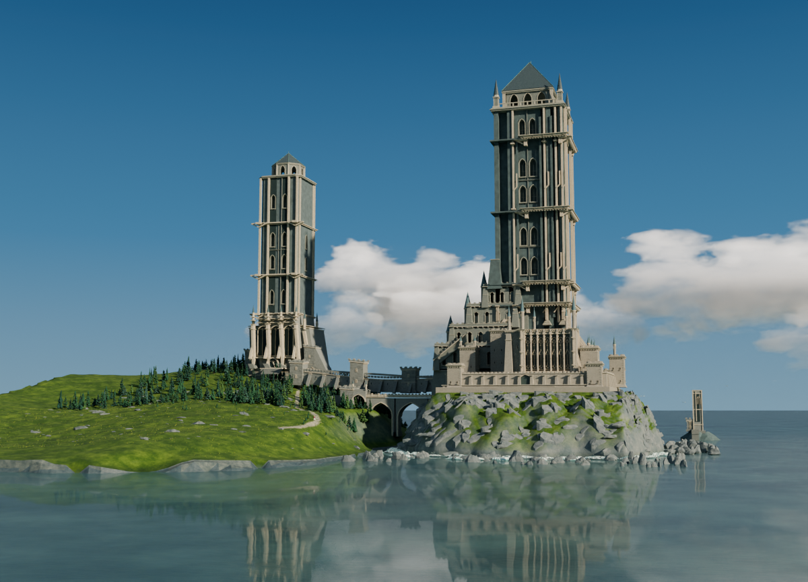
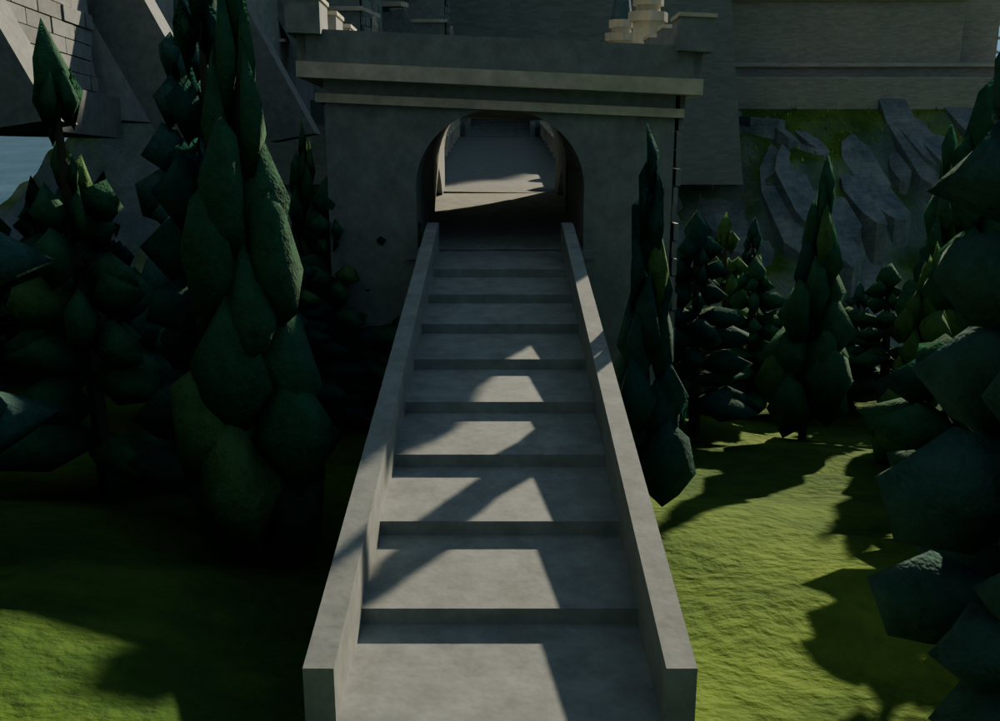
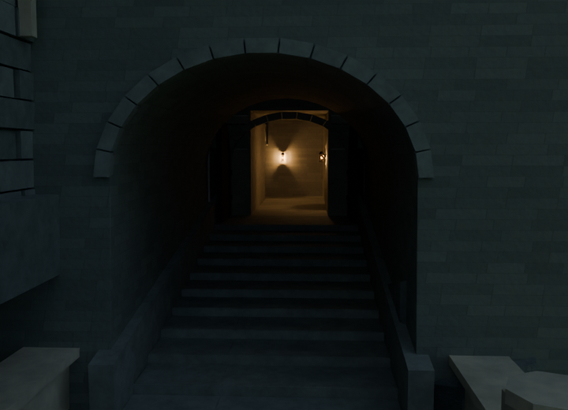
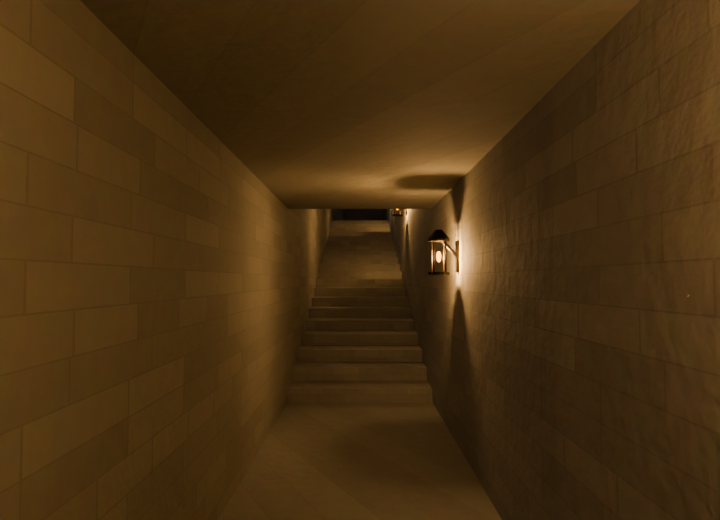
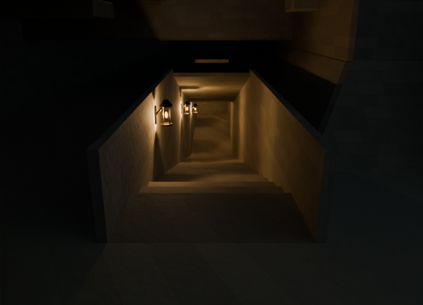
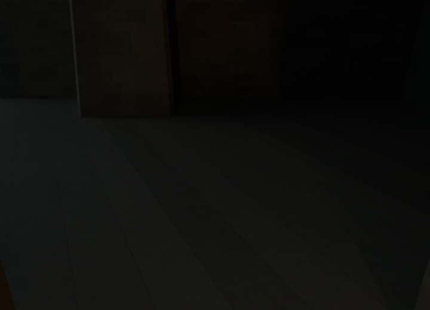
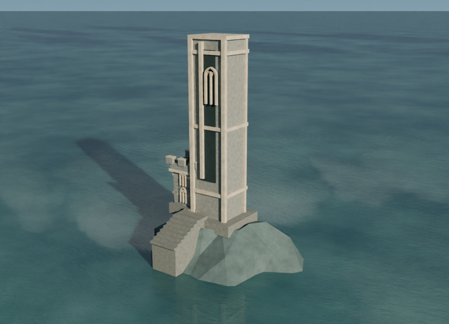

# 七个视角，看懂城堡与内廊

当前源模型为 **v016**；导航副本不覆盖它。这份导航工具不增加建筑细节，也不把相机静帧包装成可连续行走的动画。

## 先看哪里
| 全景定位 | 西侧接近路线 |
| --- | --- |
|  |  |
| 两座巨塔、连接桥和海岸。 | 树林一侧的接近方向。 |
| 东侧入口 | 内廊转角 |
|  |  |
| 桥端进入主城堡；入口不是贯穿到底的直走路线。 | 进入后向北转，再沿台阶上行。 |
| 回看上段楼梯 | 终点地面 |
|  |  |
| 从有顶露台回看阶梯。 | 明确看向已检查的终点附近，不是更远的暗房间。 |

这些都是原有世界、灯光和曝光下的实际渲染：全景及离岸小塔为v016，另外五张为v015来源的路线参考（主体路线几何与照明在v016完整保留，旧图不冒充新渲染）；没有诊断补光、去雾或隐藏遮挡。室内仍保留暗处，尤其终点只有限改善。路线参考图是720×520、24采样，全景为1600×1155、64采样，不代替高分辨率材质评估。

相机位置可以在行走范围之外（例如回看楼梯的机位），所以图序**不是碰撞验证过的行走轨迹**。已验证路线止于北侧有顶露台附近y60.5；完整验证边界见[检查点说明](../README.md)。

## 独立查看点：离岸小塔



此处是独立岛礁上的附属结构，不属于主城堡已验证通路。900×650、48采样实际照明，只展示静态台阶承托修复，不意味着有大陆连接或可进入小塔。

## 可选：生成方便查看的副本
先在仓库根目录恢复原工程：
```
python checkpoints/v016/restore_checkpoint.py
```
列出七个视角（无需Blender）：
```
python checkpoints/v016/navigation/navigation.py --list
```
使用Blender5.2.3LTS，在仓库根目录执行下列命令；如`blender`不在PATH，请换成你安装的Blender可执行文件路径：
```
blender -b --disable-autoexec checkpoints/v016/restored/castle_v016.blend --python checkpoints/v016/navigation/navigation.py -- --view bend --output castle_viewer.blend
```
输出目录必须已经存在，目标文件必须不存在。工具拒绝覆盖原工程、已有文件或符号链接目标。`castle_viewer.blend`是**另存的查看副本**，其SHA自然不同；备份与后续建模仍以原v016为基准。

可选`--view`值：`hero`、`west_approach`、`east_portal`、`bend`、`upper_stairs`、`terminal`、`offshore_marker`。

打开副本后：
- 直接从选定相机查看；各3D工作区的观察中心已移到相应区域，不再默认围绕地下原点。
- Outliner中展开`REVIEW | Optional navigation cameras`；选中所需相机，将鼠标放到3D视图，按`Ctrl+数字键盘0`将其设为活动相机。按数字键盘`0`切换相机视图。没有数字键盘时可用`View → Cameras → Set Active Object as Camera`或`Active Camera`。[Blender官方相机视图说明](https://docs.blender.org/manual/en/latest/editors/3dview/navigate/camera_view.html)。
- 原始全景相机仍保留，名字为`V002 | full coastal skyline camera`。
- 材质预览模式不等于最终照明。需要实际照明图时用渲染；本工具没有擅自切到高负载实时渲染。

## 不会改什么
只添加六个有归属标记的查看相机与一个集合，并切换副本的活动相机、选择状态和保存的视口位置。原五个外景相机、网格/属性、材质节点、灯、世界、曝光、渲染设置均保留；不嵌入自动运行脚本、不增加外部依赖。

重复安装不会堆叠相机。若同名相机/集合不是本工具创建的，或预设已被手工改动，工具拒绝操作，而不是覆盖用户内容。来源SHA固定为本版；不能直接拿它加工未来版本。

验证结果与具体例外见本目录的测试报告。唯一允许的派生网格差异是三个细分衣物对象的**求值边选择UI缓存**；实际坐标、法线、拓扑、材质和全部持久化网格字段均逐项保持一致，不采用几何误差容差。

### 复核命令
```
python -m unittest discover -s checkpoints/v016/navigation -p 'test_stdlib.py' -v
blender -b --disable-autoexec --python checkpoints/v016/navigation/test_navigation.py -- --source checkpoints/v016/restored/castle_v016.blend --outdir navigation_test_output
```
测试目录应使用新的空目录；测试会在其中生成查看副本，源文件不保存。当前23项Blender检查、5项Python测试的[本地结果](reports/local_blender_tests.json)与[来源v015的求值UI缓存对照](reports/deep_evaluation_control.json)保留。

图像渲染期间相机名称/观察中心标注有过整理，早期旁注保留当时的元数据而没有改写；[相机配方核对](renders/camera_reconciliation.json)逐张确认与最终预设一致。图像本身没有编辑。[渲染检查](renders/render_qa.json)说明暗处与采样限制。

## 可选云端线程数
实际静帧渲染脚本 `render_manifest_still.py` 新增 `--threads 8`，省略时仍为4线程，不改原工程的3线程设置。仅在有足够空闲CPU时显式使用。此云端80采样全景测试平均158.10秒降到66.15秒，四张解码像素完全相同；导航脚本本身仍24采样，不能套用该倍率。[完整对照与计算量代价](../performance/thread_abba/README.md)。
