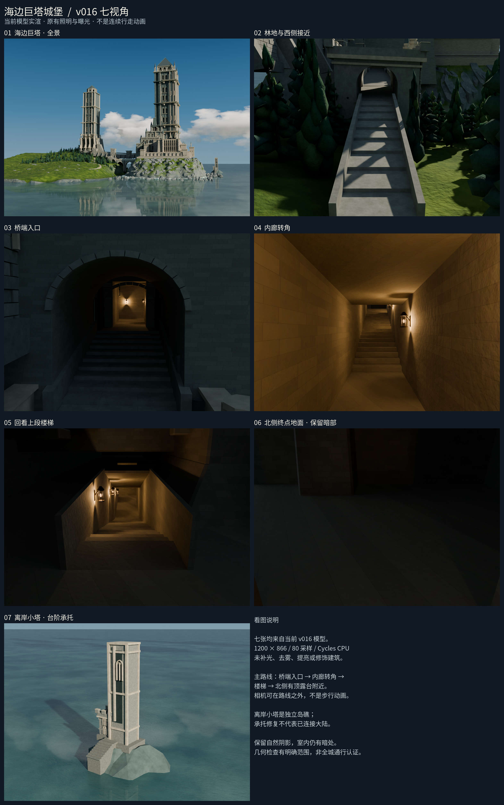

# 当前 v016 · 七视角实渲总览

[打开完整拼图](contact_sheet.png)（2460×3924 PNG）。七张全部重新渲染自当前v016，不再使用v015路线旧图。模型未改、未另建版本。



每张1200×866、原80采样/Cycles质量、原世界/灯光/曝光，云端显式8线程；总渲染656.67秒。七机位与导航清单完全一致。拼图仅加中文标签/说明，七个图块未缩放、裁剪、调色或提亮；逐块回读验证RGB完全相同。终点仍暗，明确标注；不是连续步行动画/全城通行证明。独立离岸小塔没有大陆连接。

单图及各自完整设置/来源报告位于[上级导航 renders](../renders/)。当前导航页面直接展示同一批新图，旧图仍可从Git历史恢复。

## 复现
先按根目录说明恢复v016。Linux、Python3/Pillow及兼容Blender；当前渲染调度器要求9个可用逻辑CPU、无其他Blender进程，顺序8线程。输出目录必须不存在：
```
python checkpoints/v016/navigation/gallery/render_all.py --blender /path/to/blender --source /path/to/castle_v016.blend --output-dir /new/path/renders
python checkpoints/v016/navigation/gallery/compose_contact_sheet.py --frames /new/path/renders --output /new/path/contact_sheet.png --font /path/to/NotoSansCJK-Regular.ttc
```
也可使用已保存单图重新拼图，把 `--frames` 指向 `checkpoints/v016/navigation/renders`。字体由调用方提供，未将系统字体复制进仓库。字体哈希见contact_sheet.json。渲染不保存源模型，拼图拒绝覆盖已有输出。
