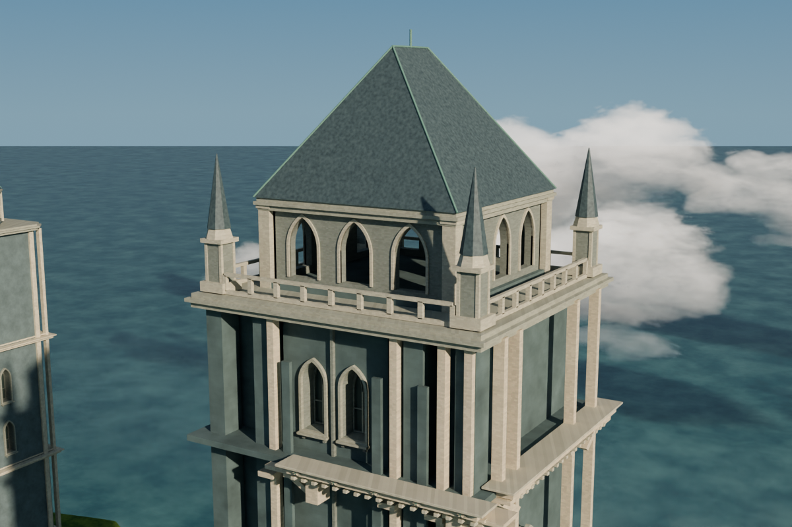

# v017 · 主冠屋面瓦片层次

四个主屋坡面补齐一致、低起伏的错缝石板瓦层次与收边；保留原屋顶实体、铜质屋脊/斜脊、中央尖杆、四座角尖塔、材质、原有灯光与主轮廓。不是另建屋顶或给所有立面铺重复石肋。

| 修改前 v016 | 修改后 v017 |
|---|---|
|  |  |

[当前整体全景](previews/hero_after_v017.png) · [北/西坡原有阴影下检查](previews/crown_rear_actual.png) · [八视角导航与独立查看副本](navigation/README.md)

## 已验证范围
- 4个新增网格对象、6,032块闭合正体积瓦片，48,336顶点/36,232面；0个原对象删除、0个原材质/灯光改动。190个原网格逐项保持；本版总计194个网格、177个可见求值网格纳入检查。
- 每块底面顶点严格在原实际凸屋体内，最小约14.996毫米；11,522组相邻行覆盖有至少14.657毫米的非共面上表面间隔，不以重合面伪造分层。
- 1,304个裁切边缘点被实际铜脊实体包覆，最小约10.081毫米；角尖塔AABB保守间隔≥0.833米。原平面外框与主屋脊高度未超出。
- 四处终端瓦顶点与原中央尖杆脚部存在明确接受的局部座接，仅z210.5…210.5103，不能理解为所有相交都允许。
- 实际网格检查拒绝三类负控制：抬离屋面的瓦片、反向面、被改动的来源屋顶。重复构建及导航验证另附报告。

1200×800冠部与1200×866全景均为原80采样实际照明；近景瓦片清晰，全景保持克制，不宣称远景发生巨大视觉变化。不是历史准确性、防水排水或承载工程认证；未凭空添加排水管，西塔八角屋帽及四座角尖塔未照搬此瓦片系统。细微天气磨损/排水设计仍是后续独立范围。

## 恢复
```
python checkpoints/v017/restore_checkpoint.py
```
用兼容Blender5.2.3LTS打开恢复出的`castle_v017.blend`。标准Python按原Zstd帧恢复，每块及整文件SHA-256验证，字节精确、不重新压缩。

本版35,671,703字节，较v016增加758,581字节（约2.17%）；内容寻址备份仍新增约15.17MB压缩块，不能把小文件增量当作Git历史增长。来源v016从Git历史`9d417969f97c309665fb37067a81785c0aa225a0`恢复。已从提交`6fd51224b13aca639e64b236fe8f1ae8da9068d4`独立拉回、校验并恢复，屋面/来源/三负控制/七旧回归组、23项导航Blender与32项Python检查通过，见`reports/remote_validation.json`。通过后才撤下旧当前模型载荷；历史保留、不强推。

## 复现与检查
构建报告记录的是生成时尚待验证的候选状态；本检查点验收以综合验证报告为准。`scripts/build_roof_courses.py`只接受指定v016来源SHA，保持所有原数据，输出到新文件；`--pitches south`仅用于历史局部试验，正式版本应四坡完整构建。
```
blender -b --disable-autoexec /path/to/v016.blend --python checkpoints/v017/scripts/build_roof_courses.py -- --output /new/path/v017.blend --report /new/path/build.json
blender -b --disable-autoexec /path/to/v017.blend --python checkpoints/v017/scripts/validate_roof_geometry.py -- --baseline-model /path/to/v016.blend --baseline-audit checkpoints/v017/reports/baseline_roof_geometry.json --report /new/path/geometry.json
```
独立查看副本不是源模型；六张路线/小塔导航参考图明确标v016，当前冠部/全景为v017。[上一版八秒真实局部环绕](https://github.com/john-wang880/seaside-megatower-castle/blob/9d417969f97c309665fb37067a81785c0aa225a0/checkpoints/v016/presentation/orbit/README.md)保留于历史，尚未包含本版屋面层次。
