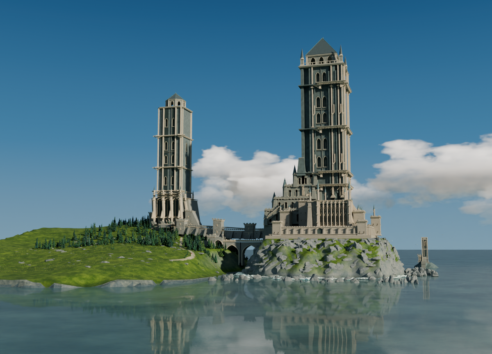
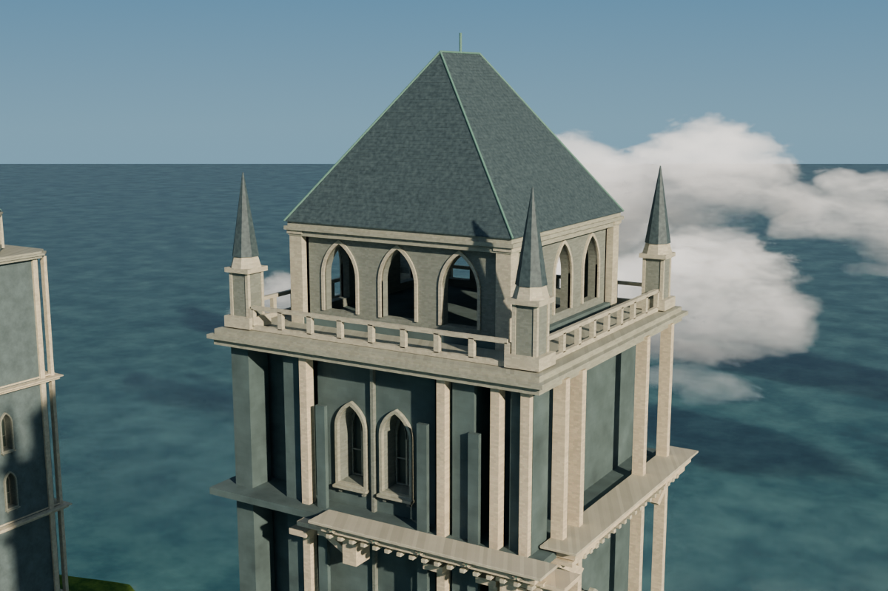
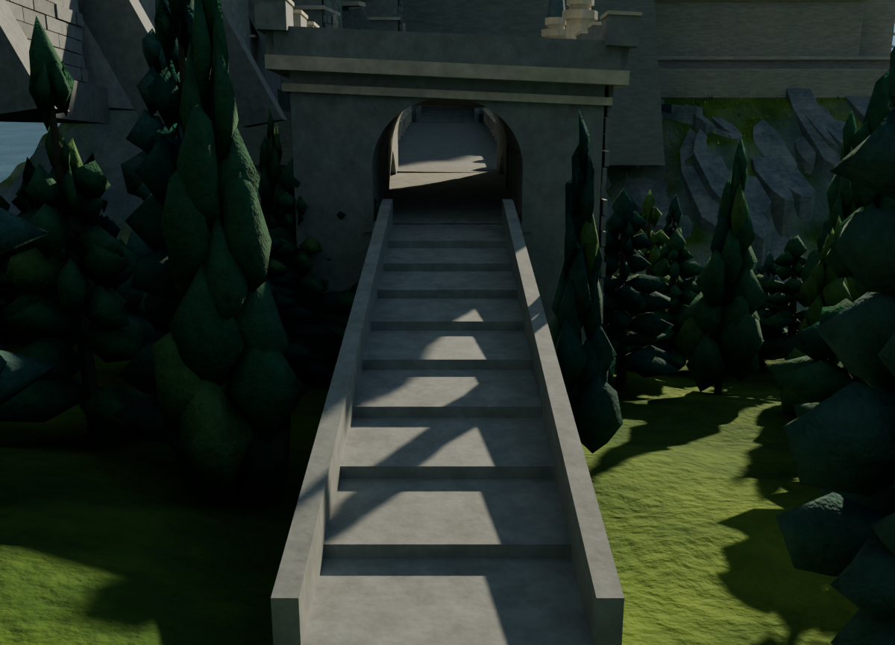
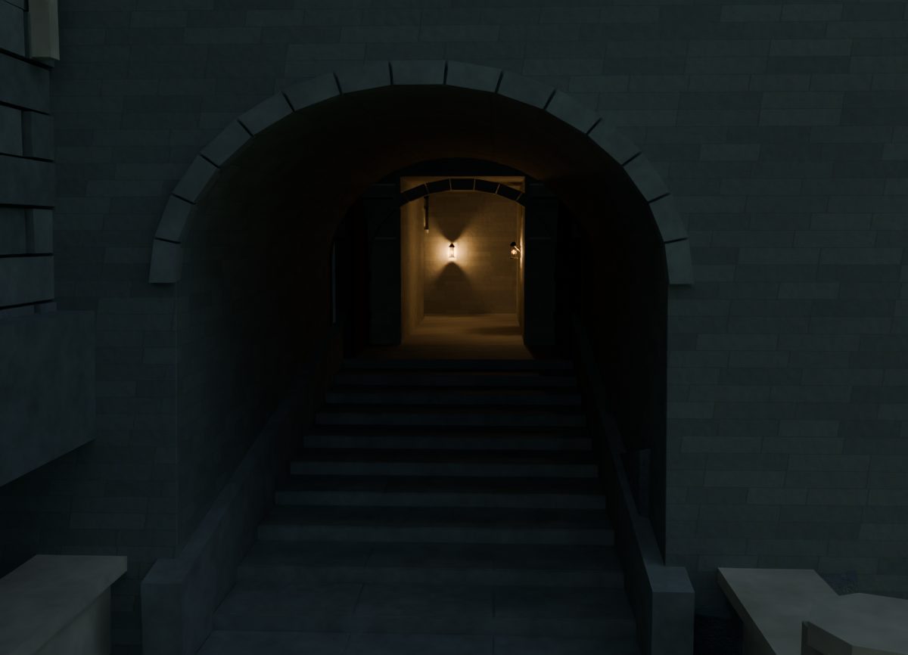
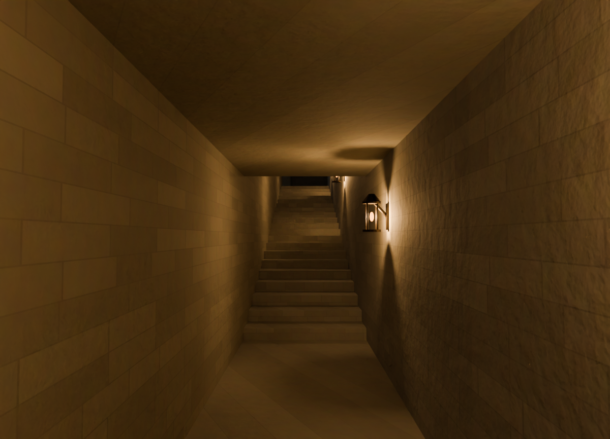
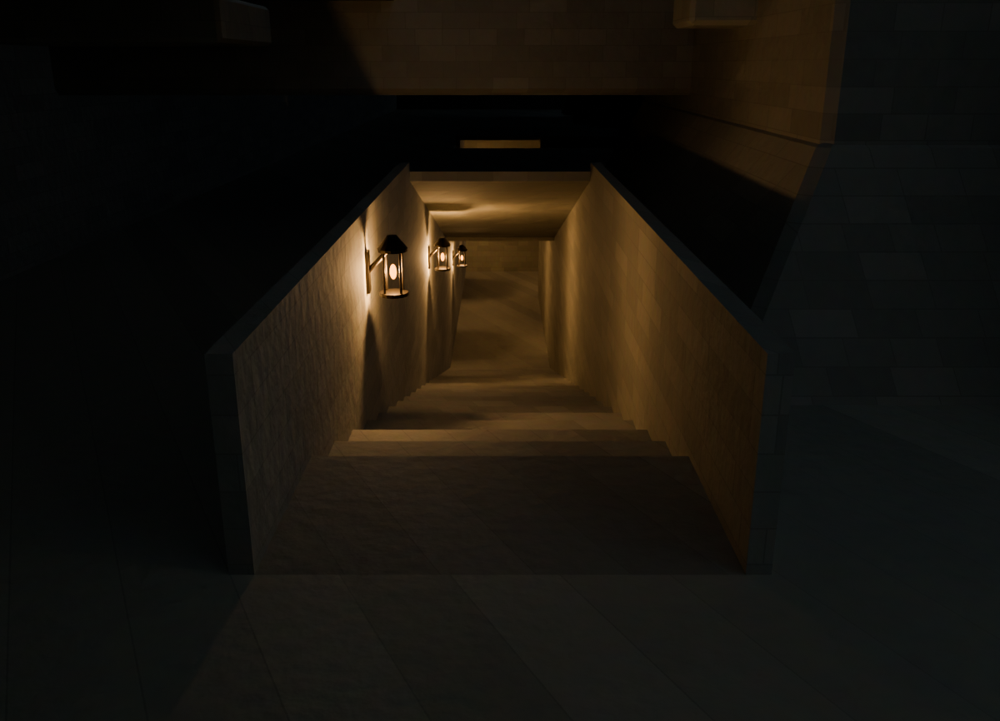
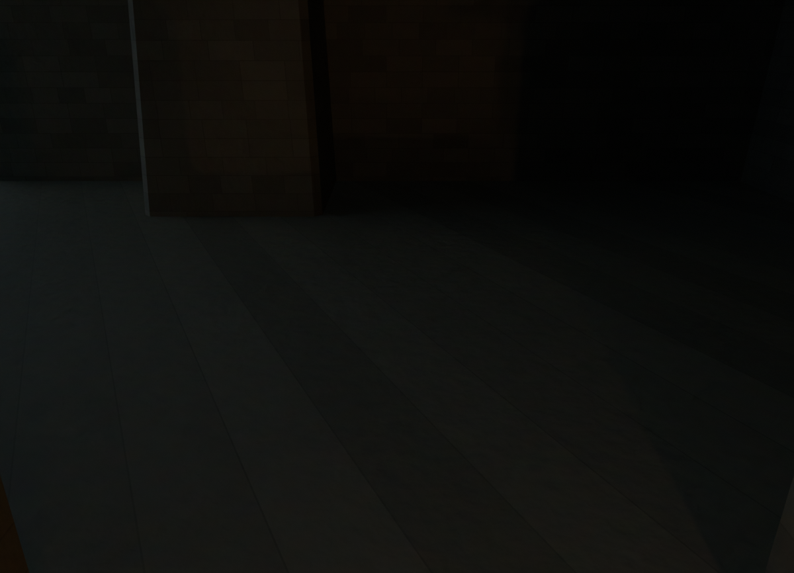
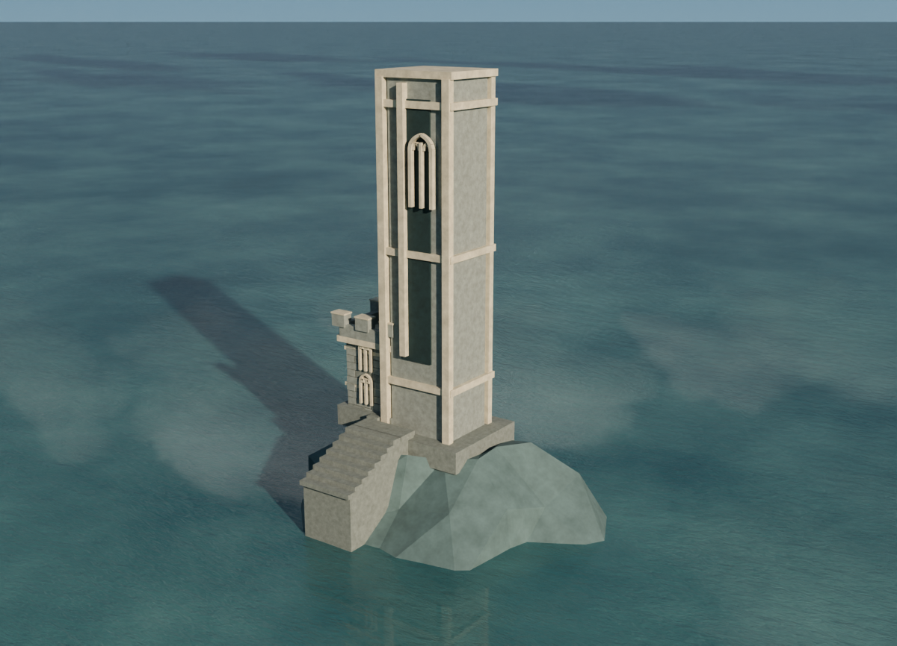

# 八视角导航 · 当前 v017

源模型为v017，查看副本不覆盖原工程。新增主冠屋面机位，便于检查瓦片层次；不是人物连续行走动画。

## 先看本版
| 全景 | 主冠屋面 |
|---|---|
|  |  |

这两张为当前v017实际渲染，80采样、原世界/灯光/曝光；全景1200×866，冠部1200×800。没有诊断补光、提亮或去雾。

## 原路线与离岸小塔参考
下面六张明确为v016来源的1200×866/80采样参考，未冒充v017新渲染。对应原路线、灯光及小塔几何在v017深度检查中完整保留；这不等于声称两版图像逐像素相同。

| 西侧接近 | 东侧入口 |
|---|---|
|  |  |
| 内廊转角 | 回看楼梯 |
|  |  |
| 终点地面，保留原有暗部 | 独立离岸小塔 |
|  |  |

实际检查路线止于北侧有顶露台附近，不是整个城堡通行/无障碍证明。相机可位于路线之外；小塔没有大陆桥，也未把装饰假门凿开。

## 生成可选查看副本
先恢复源文件：
```
python checkpoints/v017/restore_checkpoint.py
blender -b --disable-autoexec checkpoints/v017/restored/castle_v017.blend --python checkpoints/v017/navigation/navigation.py -- --view crown --output /new/path/castle_viewer.blend
```
输出必须是另一个尚不存在的.blend文件。此工具只增加7个自有检查相机、使用已有全景相机，设置查看视角/选择；不会覆盖源文件或加入照明/建筑。`--list`列出8个机位。查看副本里的相机操作可参考[Blender相机视图手册](https://docs.blender.org/manual/en/latest/editors/3dview/navigate/camera_view.html)。

当前验证结果见reports；原三个细分衣物的求值边选择UI缓存例外与实际渲染几何严格分开，不能当作允许几何变化的容差。原模型保存的3线程设置不改，实际静帧工具显式`--threads`默认4；云端8线程性能结果仅对历史v016测试适用，不能套用本版所有机位。
