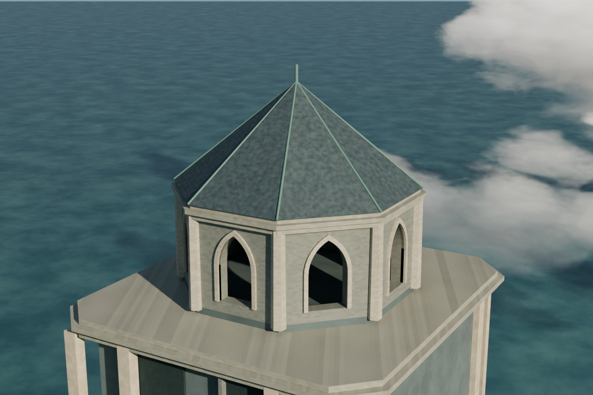

# v018 · 西塔低屋帽石板瓦层次

在原八角低屋帽上加入克制、错缝的石板瓦课程，保持较主冠简单的造型。原屋体、八条铜斜脊、细尖杆、材质和灯光不改；不复制主冠尖塔，也不扩大森林。

| v017 修改前 | v018 修改后 |
|---|---|
|  |  |

这是**近景的小幅构造层次提升**，不是全景大改。原80采样照明、相同相机比较；不靠重新打光制造改善。[整体全景](previews/hero_after_v018.png) · [另一侧检查](previews/west_cap_opposite_actual.png) · [九视角导航](navigation/README.md)

## 验证范围
- 八个新增网格，共2,096块闭合、正体积、定向一致瓦片；16,848顶点/12,616面。原194个网格保留，当前202个网格/185个可见求值网格纳入深度检查。
- 实际八坡面逐项检查：底面顶点全部嵌入原凸屋体，最小半空间余量约7.660毫米；3,736组相邻行重叠，上表面间隔至少5.982毫米。
- 按原实际铜脊实体（包括端盖）检查边缘，最小包覆约2.359毫米；不是把较大的径向估计当成完整包覆余量。原八角檐边和高度不超出，尖杆无相交或不确定接触。
- 三种负控制分别抬离瓦片、反转面、改动来源屋帽，均在预定不变量被拒绝。重复构建持久语义一致；不是要求不同保存过程产生同一文件字节。
- 原主冠v017全部瓦片、森林、人物、材质、灯光、相机与场景保持。三个人物网格的求值UI边选择缓存与原有导航测试一致，差异明确限定；持久数据、所有渲染几何和其余求值字段均精确一致。
- 旧路线/桥段/门/铰接/地面支撑回归另列报告，仍是原有静态、有边界的检查，不是整座城堡连续可达或无障碍认证。

反向视角的强亮侧坡在同相机v017基线中已存在，见配对报告；本版未改动其照明或材质，也不宣称解决该既有外观。

不宣称历史准确性、防水排水或承载工程认证。单次渲染时长仅作记录，不是性能基准。

## 恢复和复现
```
python checkpoints/v018/restore_checkpoint.py
```
兼容Blender5.2.3LTS。模型35,962,496字节，SHA-256 `c46b581a759c1b6d494fb3b31e9a7c42f749b6dfbdde1c00befbfebd9ef44cfd`。分块和整文件校验后字节精确恢复。比v017增加290,793字节，但新增备份压缩块16,420,539字节；不能把原文件小增量称为Git历史同等节省。

来源v017保留于Git历史 `896e5c4e717e60a04dc1a25ba4c4c1632668f385`。先发布新增备份、独立远端恢复验证，再撤下旧当前载荷；不强推、不清除历史。已从远端提交`3322030e311e8857c4b9d444b4a122027f7643e1`精确恢复并复验：实际屋帽几何/来源/三负控制/七回归组、27导航Blender与32Python检查通过，见`reports/remote_validation.json`。

```
blender -b --disable-autoexec --python checkpoints/v018/scripts/build_western_cap.py -- --baseline /path/v017.blend --output /new/path/v018.blend --report /new/path/build.json
blender -b --disable-autoexec --python checkpoints/v018/scripts/validate_geometry.py -- --baseline-model /path/v017.blend --candidate /path/v018.blend --design checkpoints/v018/scripts/design.json --report /new/path/geometry.json
```

构建成功不等于验收，最终判断见 `reports/acceptance_summary.json`。本版未采用前景针叶试验：稀疏枝片损失树冠体量，已拒绝；[配对实际渲染和拒绝证据](audits/foreground_rejected/README.md)仅供记录，不包含或宣称可恢复该弃用模型。

导航西塔屋帽/全景为v018新渲染；主冠参考图为v017，六张路线/小塔图为v016，均明确来源。历史[v016八秒局部环绕](https://github.com/john-wang880/seaside-megatower-castle/blob/9d417969f97c309665fb37067a81785c0aa225a0/checkpoints/v016/presentation/orbit/README.md)未包含后续屋面，不称为v018视频。

## 不改模型的后续呈现
[入口内廊至露台相机预览计划](presentation/interior_route/README.md)已保存可复现脚本、连续相机空间检查与分阶段渲染计划；目标28秒/12fps/336张真实帧，**尚未完成视频**。先渲染25张覆盖入口、转角、开口和终点的试片，通过实际画面复核后才继续其余帧。

[草岩交界只读审查](audits/landscape_transition/README.md)得到有用否定结果：当前展示尺度未见值得局部改动的明显边界问题，保留v018，不凭空散布植被或重复湿润/浪花调整。
