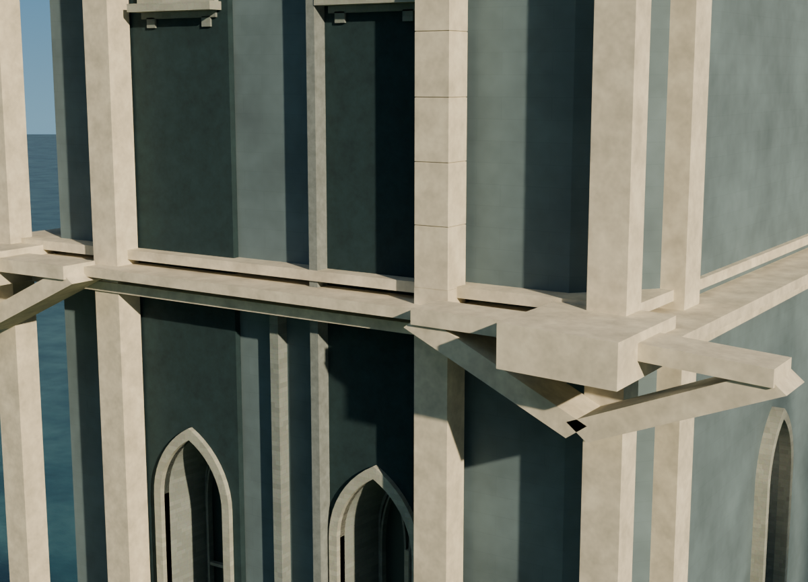
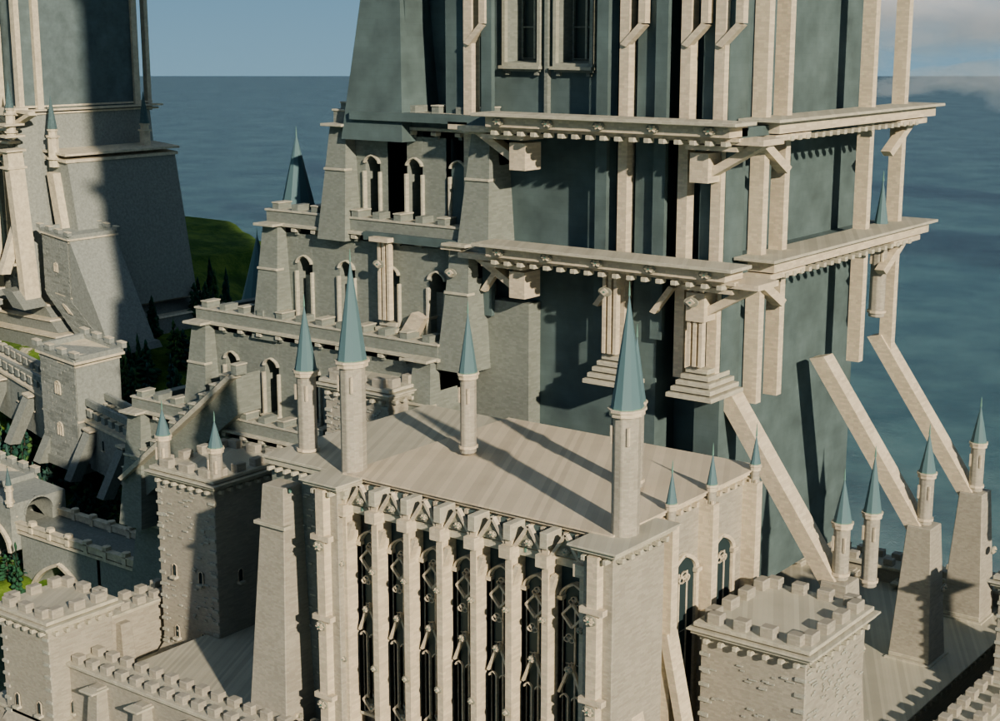

# 回廊 / 檐托 / 窗框局部复核：保留v018

[几何结论与边界](GEOMETRY_REVIEW.md) · [独立视觉结论](visual/decision.json)

| 西塔檐托与石肋样板 | 主塔下层回廊带 |
|---|---|
|  |  |

两张均为当前v018真实几何、原80采样/光照/曝光，1200×866。为看清此前未覆盖局部而新增相机，不是前后优化对比；没有模型变化。

西塔尖片被证实为闭合且有接触的成对斜檐托。主塔栏杆四组各11件内部相连；下层430个采样构件闭合不等于全部接触认证。实景未找到应修的悬空件或不连贯形体。隐藏面、所有外部锚接、承重和全城正确性不在范围内。

`components_extended.json`是源SHA绑定的提取几何，`offline_contacts.py`可在其同目录对该快照重算接触报告（会更新同目录报告，建议复制目录后运行）。它不是重新读取blend的全场景测试；分析凸包后另用实际面三射线内点检查，边界见报告。原始配方来自Git历史91f2c7d；未额外复制整套旧版本。`visual/render_reviews.py`为此次Linux只读相机渲染脚本，含明确source/output参数；不保存工程，不声称Windows可直接运行。

保留有意的窗群留白和两段石肋样板，不机械扩展铺满，不因细节尖锐就推定错误。
