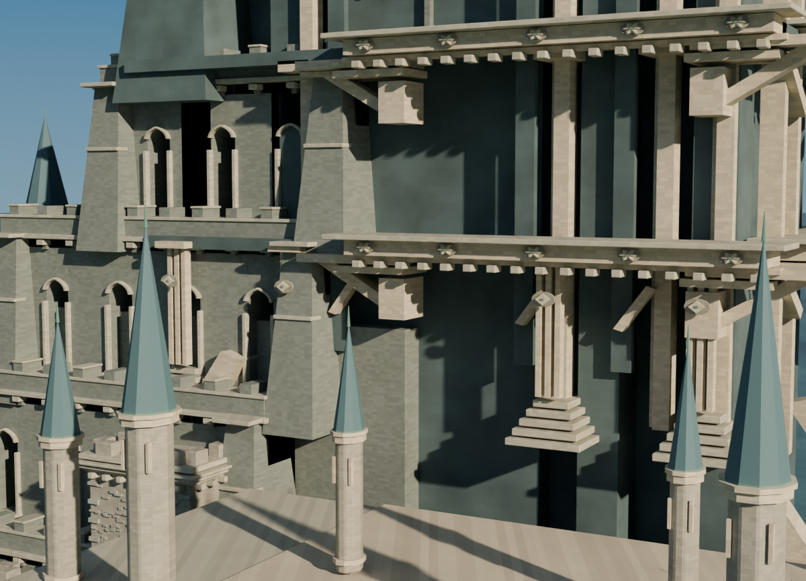

# 四菱形贴饰实景关口：不新增背部固定件

当前v018、1200×866、原80采样/世界/灯光/曝光；临时相机约28度斜看，包含四枚贴饰及相邻立肋/檐托作尺度参照。不是修改后图，也没有新模型。

几何检查确实发现装饰与已连接结构的间隙；四枚贴饰中心与各自主肋对齐，条件性的小背部固定件在几何上可行。但实际图中它们读作浅浮雕纽饰，未清晰呈现需要修的透光间隔或缺失连接。负责人、实施者与独立视觉审查均认为没有足够可见收益，不构建候选、不追加放大机位。

这不撤销已测间隙，也不保证其他方向或物理用途都正确。112个局部装饰分离与17个邻域受限目标仍是明示边界；未把它们宣布全部修复。若未来需要近距离可拆装资产、几何打印或实际接触完备性，应重新明确标准后处理。当前以已交付视觉用途保留v018。

[条件性宿主/固定件分析（未实施）](HOST_CONCEPT.md) · [独立实际图审查](visual/decision.json)。原始源/参数/相机哈希见同目录JSON。原始渲染脚本为本次Linux相机诊断证据，不保存模型。
