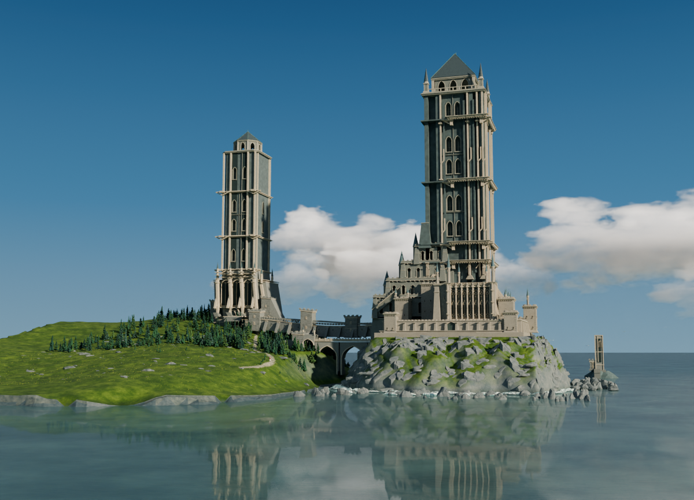
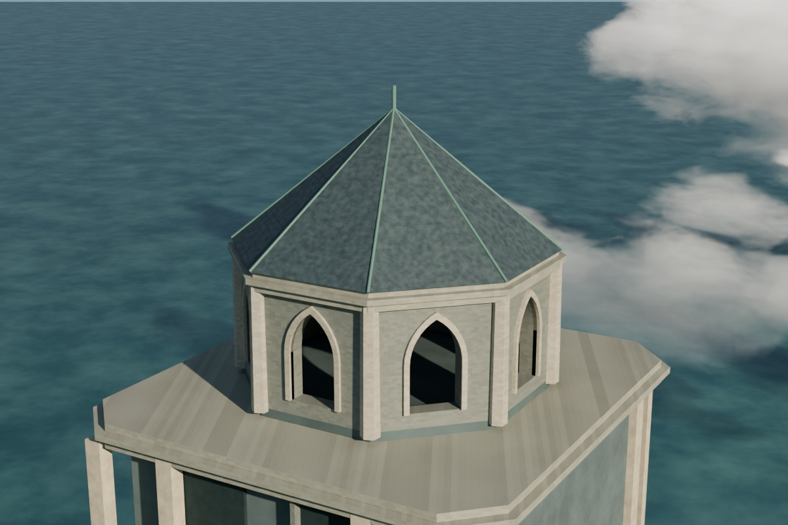
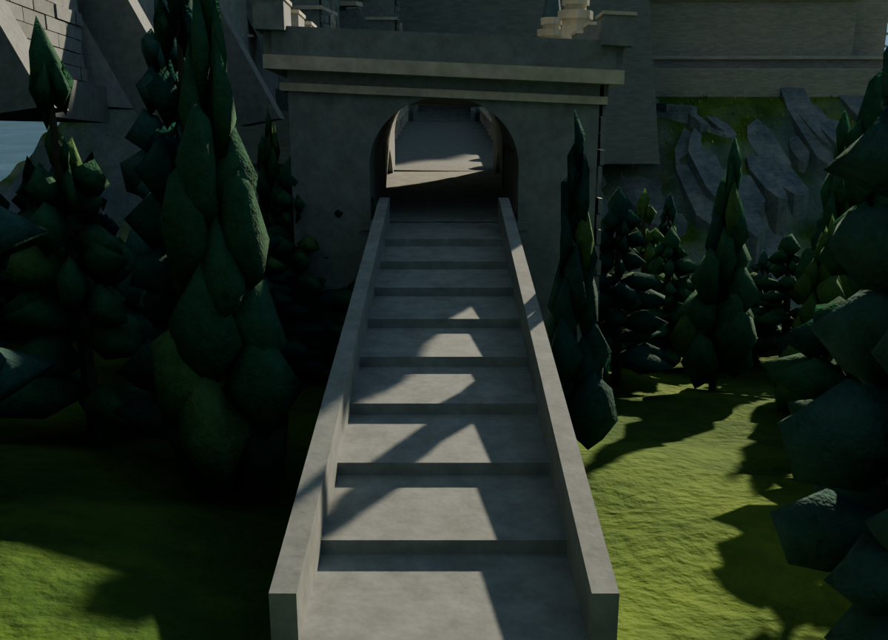
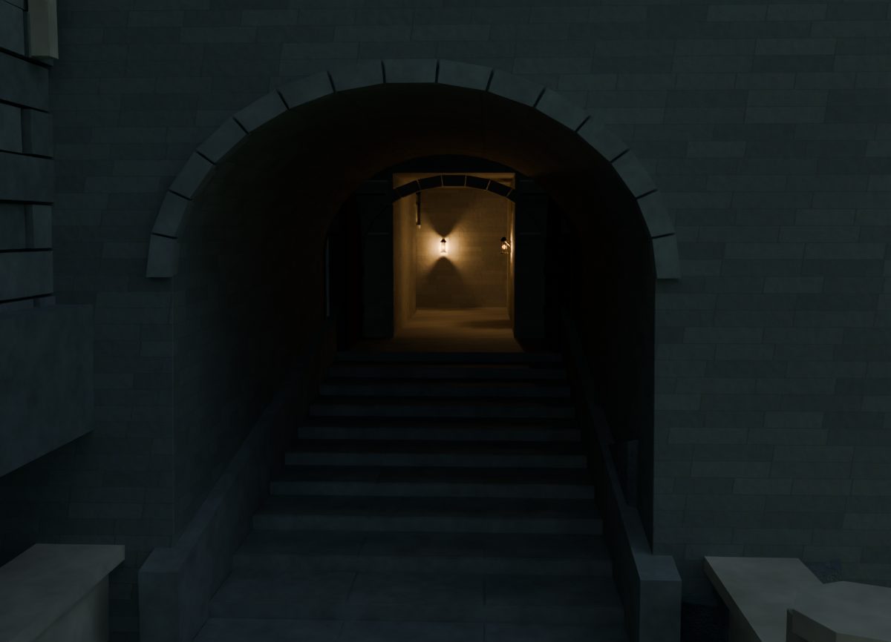
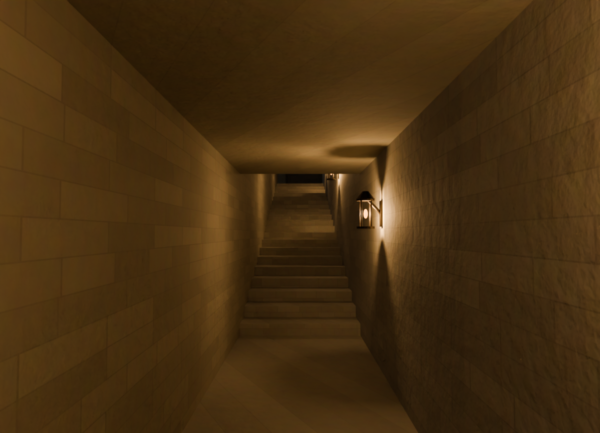
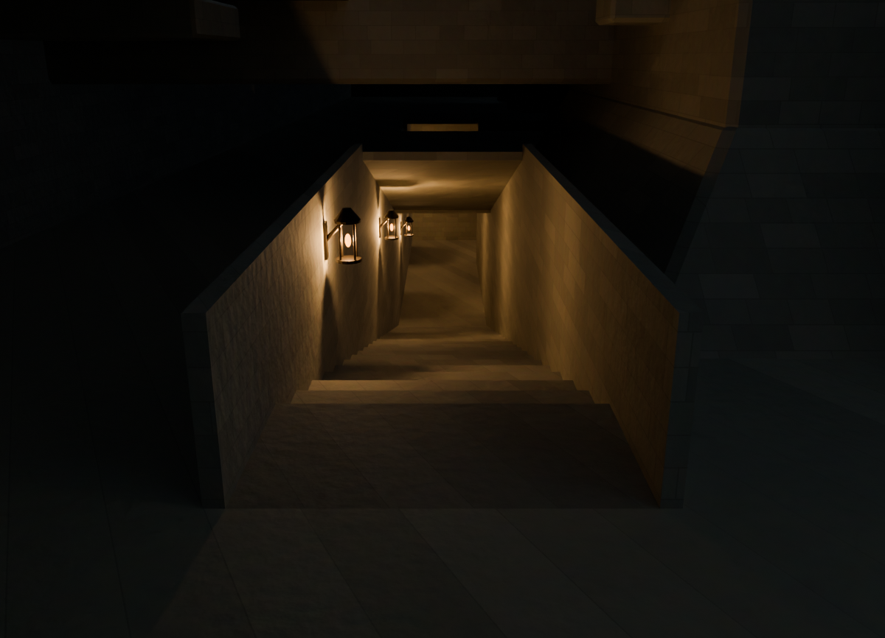
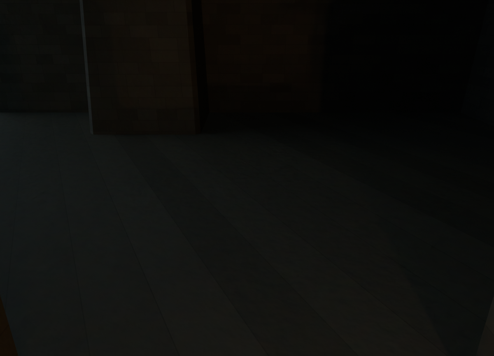
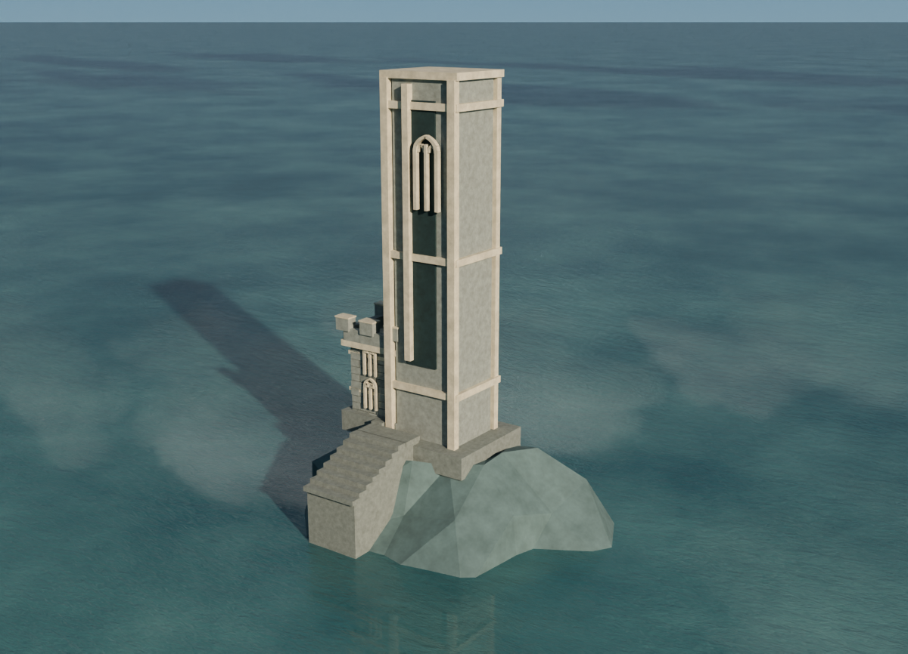
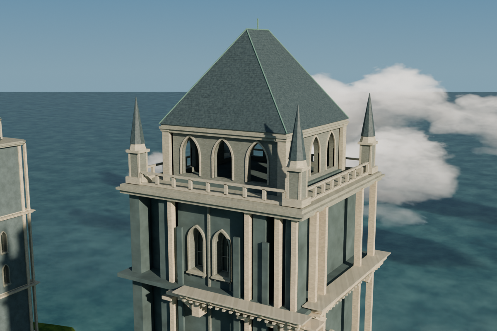

# 九视角导航 · v018

新增西塔低矮八角屋帽检查相机，不改路线、建筑、照明或原工程。
这是相机静帧与可选查看副本，不是人物连续行走或全城通行证明。

## 当前版本图片

本版实际渲染：

| 全景 | 西塔低矮屋帽 |
|---|---|
|  |  |
全景1200×866、西塔屋帽1200×800，原80采样/世界/灯光/曝光。
最终图片来源与SHA见各自JSON，不使用旧原型图片冒充最终版。

## 明确保留的历史参考

| 参考视角 | 图片来源 |
|---|---|
| 主冠屋面 `renders/crown.png` | v017，主冠瓦片参考 |
| 西侧接近、东入口、内廊、楼梯、终点、小塔 | v016，各自原始JSON保留 |

| 西侧接近（v016） | 东侧入口（v016） |
|---|---|
|  |  |
| 内廊转角（v016） | 回看楼梯（v016） |
|  |  |
| 终点暗部（v016） | 离岸小塔（v016） |
|  |  |

主冠屋面（v017）：

详见 `reports/historical_image_provenance.json`。这些未重渲染为v018，
也不声称逐像素等价。终点原有暗部保持；离岸小塔是独立资产。
历史v016八秒局部环绕视频仍为v016来源，不冒充v018影片。

## 可选查看副本

恢复当前源模型后：
```
blender -b --disable-autoexec castle_v018.blend --python navigation.py -- --view west_crown --output /new/path/castle_viewer.blend
```
输出必须为另一个尚不存在的.blend文件。工具仅新增8个自有检查相机、
复用已有全景相机，并设置查看/选择状态；不覆盖源文件。`--list`列出9视角。

原静帧辅助工具 `render_manifest_still.py` 维持720×520/24采样快速预览，
默认4线程、可显式传 `--threads 8`；不能与本次原80采样正式静帧混淆。
原质量脚本 `render_hero_original_quality.py` / `render_crown_original_quality.py`
只在云端临时使用8线程，不修改源文件保存的3线程默认。

验证通过：9项标准Python测试，27项Blender深度原数据/查看副本断言。见reports。
源SHA：`c46b581a759c1b6d494fb3b31e9a7c42f749b6dfbdde1c00befbfebd9ef44cfd`。

九张图片的完整来源映射：`reports/all_nine_image_provenance.json`；本版两相机实际姿态核对：`reports/current_camera_reconciliation.json`。
后侧屋帽亮白斜面在匹配v017基线中已存在，见`reports/rear_paired_visual_review.json`；不归因为新增瓦片，也不借此判断原材质原因。
